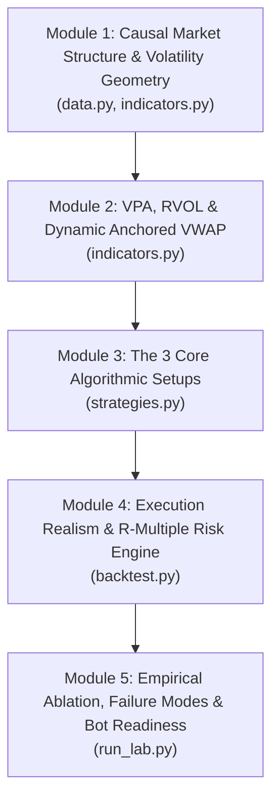

# Quantified Price Action & AVWAP Systems — Fast-Track Curriculum

> **Level:** Mid-to-Advanced (Zero beginner fluff)
> **Objective:** Master the mathematical, structural, and code-level mechanics of institutional **Price Action + Volume Price Analysis (VPA) + Anchored VWAP (AVWAP)** strategies in the shortest possible time, mapped directly to `labs/01-pa-avwap-lab/`.

---

## Course Architecture

---

## Module 1: Causal Market Structure & Volatility Geometry
**Target Code:** `labs/01-pa-avwap-lab/pa_bot/data.py`, `labs/01-pa-avwap-lab/pa_bot/indicators.py`

### 1.1 Bar Micro-Geometry & ATR Normalization
* Why raw dollar/percentage thresholds fail across regimes and assets.
* Wilder's $\text{ATR}_{14}$ recurrence: $\text{ATR}_t = \frac{13 \cdot \text{ATR}_{t-1} + \text{TR}_t}{14}$.
* Dimensionless candle anatomy:
  * **Close Position:** $\text{CP}_t = \frac{C_t - L_t}{H_t - L_t} \in [0, 1]$ (institutional closing conviction).
  * **Rejection Tail Ratio:** $\frac{\min(O_t, C_t) - L_t}{H_t - L_t}$ (measuring intrabar liquidity absorption).

### 1.2 Lookahead-Free Fractal Pivots (`pivot_left`, `pivot_right`)
* **The #1 Backtest Bug:** Centered window extrema (`min(low[i-5 : i+5])`) leak future bars into bar $i$.
* **Causal Confirmation Lag:** A candidate Swing Low at index $p = i - R$ is only confirmed at bar $i$ close after $R$ subsequent bars fail to undercut $L_p$:
  $$L_p \le \min_{k \in [p-L, p-1]} L_k \quad \land \quad L_p < \min_{k \in [p+1, i]} L_k$$
* Tradeoff between confirmation speed ($R=2$) and structural significance ($L=5$).

### 1.3 Structural Regime State Machine
* Combining confirmed pivot sequences ($SH_1 > SH_0 \land SL_1 > SL_0$) with institutional trend alignment ($C_t > \text{SMA}_{50} \ge \text{SMA}_{200}$).

---

## Module 2: Institutional Volume Price Analysis (VPA) & Anchored VWAP
**Target Code:** `labs/01-pa-avwap-lab/pa_bot/indicators.py`

### 2.1 Event-Anchored VWAP vs. Session VWAP
* Why Session VWAP is meaningless on Daily bars, and how institutions track cumulative cost basis from structural pivots:
  $$\text{AVWAP}_{t_0 \to t} = \frac{\sum_{k=t_0}^{t} \text{TP}_k \cdot V_k}{\sum_{k=t_0}^{t} V_k}, \quad \text{TP}_k = \frac{H_k + L_k + C_k}{3}$$
* **$O(1)$ Prefix-Sum Implementation:** Precomputing `cum_tp_vol` and `cum_vol` arrays so arbitrary anchor queries run in constant time without nested loops.

### 2.2 Dynamic Dual-Anchor Mechanics
* **Swing-Low AVWAP (`avwap_swing_low`):** Average cost basis of buyers since the most recent confirmed structural low. Acts as dynamic institutional support on pullbacks.
* **Swing-High AVWAP (`avwap_swing_high`):** Average cost basis of trapped longs/sellers since the most recent peak. Clearing `avwap_swing_high` confirms overhead supply is absorbed.

### 2.3 Relative Volume ($\text{RVOL}$) & Wyckoff Effort-vs-Result
* Normalizing participation via $\text{RVOL}_t = \frac{V_t}{\text{SMA}(V, 20)}$.
* Three distinct institutional signatures:
  1. **Supply Dry-Up ($\text{RVOL} \le 0.85$):** Pullback or coil bars show absence of institutional selling.
  2. **Stopping Volume ($\text{RVOL} \ge 1.10$ on sweeps):** High volume at a structural breakdown level that closes back inside range = limit-order absorption.
  3. **Breakout Expansion ($\text{RVOL} \ge 1.15\text{–}1.20$):** Wide-range close through resistance backed by participation.

---

## Module 3: The Three Core Algorithmic Price Action Archetypes
**Target Code:** `labs/01-pa-avwap-lab/pa_bot/strategies.py`

### 3.1 Archetype 1 — Trend Pullback to Structure + AVWAP (`TrendPullbackStrategy`)
* **Location:** Structural uptrend pulling back into the value zone bounded by $\max(\text{SMA}_{20}, \text{AVWAP}_{\text{SL}}) + 0.35\text{ ATR}$.
* **VPA + Trigger:** Prior bar dry-up ($\text{RVOL}_{t-1} \le 0.90$) or trigger expansion ($\text{RVOL}_t \ge 1.15$), bullish bar breaking $H_{t-1}$ with $\text{CP}_t \ge 0.65$ and closing above both `avwap_swing_low` and `rolling_vwap_20`.
* **Invalidation:** Structural stop at $\min(L_t, L_{t-1}, L_{t-2}) - 0.25\text{ ATR}$.

### 3.2 Archetype 2 — Liquidity Sweep / Wyckoff Spring (`LiquiditySweepStrategy`)
* **Stop-Run Mechanics:** Why retail stops cluster just below prior 10-bar / Swing Lows, and how institutions engineer liquidity sweeps ($L_t < \text{Support} - 0.03\text{ ATR}$) to fill large buy orders.
* **Reclaim & Absorption:** Closing back above `support_level` with $\text{CP}_t \ge 0.60$, Stopping Volume ($\text{RVOL}_t \ge 1.10$), and reclaiming the Swing-Low AVWAP zone.
* **Empirical Proof:** Why trading sweeps *without* VPA/AVWAP loses money ($-0.10R$/trade, $-17.2R$ net) vs. *with* VPA/AVWAP ($+0.16R$/trade, $+4.7R$ net).

### 3.3 Archetype 3 — Volatility Contraction Pattern Breakout (`VolatilityContractionBreakoutStrategy`)
* **Compression Coil:** 6-bar average range contracting below $0.95\text{ ATR}_{14}$ inside a tight 10-bar channel ($\le 3.6\text{ ATR}_{14}$) with at least one volume dry-up bar ($\text{RVOL} \le 0.85$).
* **Breakout & Climax Filter:** Closing above the 10-bar ceiling with $\text{CP}_t \ge 0.70$, $\text{RVOL}_t \ge 1.15$, above all active AVWAPs, while rejecting overextended climax bars ($\text{Range}_t > 1.85\text{ ATR}$).
* **Structural Stop Anatomy:** Why placing stops inside the breakout candle body gets wicked out on normal retests, and why $\min(L_t, L_{t-1}) - 0.20\text{ ATR}$ jumps Expectancy from $+0.02R \to +0.50R$ (Profit Factor $2.11$).

---

## Module 4: Event-Driven Execution Realism & $R$-Multiple Risk Engine
**Target Code:** `labs/01-pa-avwap-lab/pa_bot/backtest.py`

### 4.1 Execution Path Pathology & Anti-Cheat Rules
* **Overnight Gap-Through-Stop (`STOP_GAP`):** When bar $j$ opens below `active_stop`, you do *not* get filled at `active_stop`—you fill at $\text{Open}_j \times (1 - \text{slippage})$.
* **Intrabar Conservative Precedence:** If a daily bar hits both `active_stop` and `target` on the same bar, stop-loss is evaluated first.

### 4.2 Dynamic Trade Management
* **Breakeven Ratchet:** Moving `active_stop` to $\text{Entry} + 0.10R$ once unrealized close reaches $+1.5R$.
* **Time Stops (`TIME_EXIT`):** Exiting stagnant trades after `max_hold_bars` (12–18 days) when momentum fails to materialize.

### 4.3 Portfolio Sizing & Expectancy Math
* Fixed-fractional position sizing:
  $$\text{Shares} = \left\lfloor \frac{\text{Equity} \times \text{Risk\%}}{\text{EntryFill} - \text{StopLoss}} \right\rfloor$$
* Measuring strategy health via $E_R$, Profit Factor ($\frac{\sum R^+}{|\sum R^-|}$), and Max Drawdown in $R$.

---

## Module 5: Empirical Ablation, Failure Modes & Live Bot Architecture
**Target Code:** `labs/01-pa-avwap-lab/run_lab.py`

### 5.1 Ablation Study (Pure PA vs. PA + AVWAP/VPA)
* Analyzing the trade-frequency vs. drawdown tradeoff across all 3 setups.
* Diagnosing why Pure PA suffers $2.5\times\text{–}5\times$ larger drawdowns during choppy/bear regimes (2022 tape).

### 5.2 Stress-Testing Across Asset Classes & Timeframes
* Comparing index ETFs (`SPY`, `QQQ`, `IWM`) vs. high-beta momentum leaders (`NVDA`, `META`, `AMZN`) and `1d` vs. `1h` bars.

### 5.3 Blueprint for `labs/02-live-scanner-bot` (Optional Extension)
* Turning `evaluate(contexts, len(contexts) - 1)` into an end-of-day scanner and paper-trading execution loop with portfolio heat caps.

---

## How We Run Each Lesson
1. **Pick the active module/topic** from `PROGRESS.md`.
2. We inspect the **exact lines of code** in `labs/01-pa-avwap-lab/` alongside real trade examples from the 5-year dataset.
3. You ask questions on any formula, market mechanic, or code block until it is 100% clear.
4. You complete the **Verification Check** in `PROGRESS.md` to mark the module complete and advance.
