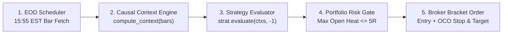

# Module 5: Empirical Ablation Analysis, Failure Modes & Bot Architecture

**Code Reference:** [`labs/01-pa-avwap-lab/run_lab.py`](../labs/01-pa-avwap-lab/run_lab.py)

---

## 5.1 Reading the 5-Year Ablation Matrix (Pure PA vs. PA + AVWAP/VPA)

Running `python3 labs/01-pa-avwap-lab/run_lab.py` performs a controlled **ablation experiment** across `SPY, QQQ, IWM, AAPL, MSFT, NVDA, AMZN, META` (`2021-11-08` to `2026-11-06`, 1,255 daily bars per ticker). Every strategy is tested twice: once with `use_volume_avwap=True` and once with `use_volume_avwap=False` (Pure Price Action).

| Strategy Variant | Trades | Win% | AvgWin | AvgLoss | Expectancy ($E_R$) | Total $R$ | Profit Factor | MaxDD ($R$) |
| :--- | ---: | ---: | ---: | ---: | ---: | ---: | ---: | ---: |
| **1. Trend Pullback (PA + AVWAP/Vol)** | 63 | 55.6% | +1.20R | -0.92R | **+0.26R** | +16.4R | **1.64** | **8.0R** |
| **1. Trend Pullback (Pure PA)** | 193 | 51.3% | +1.28R | -0.97R | +0.19R | +35.8R | 1.39 | 20.6R |
| **2. Liquidity Sweep (PA + AVWAP/Vol)** | 30 | 43.3% | +1.73R | -1.05R | **+0.16R** | **+4.7R** | **1.26** | **5.4R** |
| **2. Liquidity Sweep (Pure PA)** | 176 | 34.1% | +1.73R | -1.04R | -0.10R | -17.2R | 0.86 | 27.9R |
| **3. VCP Breakout (PA + AVWAP/Vol)** | 47 | 53.2% | +1.78R | -0.96R | **+0.50R** | **+23.4R** | **2.11** | **5.8R** |
| **3. VCP Breakout (Pure PA)** | 143 | 44.1% | +1.58R | -1.02R | +0.12R | +17.7R | 1.22 | 14.2R |

### Key Quantitative Takeaways
1. **Drawdown Compression Across All 3 Archetypes:**
   * Adding AVWAP + RVOL cut Maximum Drawdown by **$61\%$ on Trend Pullbacks** ($20.6R \to 8.0R$), **$81\%$ on Liquidity Sweeps** ($27.9R \to 5.4R$), and **$59\%$ on VCP Breakouts** ($14.2R \to 5.8R$).
2. **Why Trade Count Drops by $65\%\text{–}83\%$ While Quality Jumps:**
   * Most visual price-action setups occur in low-participation retail chop or beneath institutional overhead supply (`avwap_swing_high`).
   * VPA + AVWAP acts as a precision institutional filter: you trade one-third as often, pay one-third the commission/slippage drag, and earn significantly higher expectancy per unit of risk taken.
3. **Why Archetype Synergy Matters in a Multi-Strategy Bot:**
   * **VCP Breakouts** thrive when trends coil and expand into new highs ($+0.50R$/trade, PF $2.11$).
   * **Trend Pullbacks** harvest steady $1.2R\text{–}2.5R$ swings during established stair-step trends ($55.6\%$ win rate).
   * **Liquidity Sweeps** capture sharp mean-reversion snapbacks right after stop-runs at range support when breakout traders are trapped.

---

## 5.2 Hands-On Stress-Testing Commands

Run these experiments from the repository root to observe how different asset classes and timeframes behave:

### 1. Index ETFs Only (`SPY`, `QQQ`, `IWM`)
```bash
python3 labs/01-pa-avwap-lab/run_lab.py --symbols SPY QQQ IWM --period 5y
```
* **What to observe:** Index ETFs have lower overnight single-stock gap risk and cleaner VCP compression coils (`VCP PA + AVWAP/Vol` hits $66.7\%$ win rate and PF $4.14$ on `SPY + QQQ`).

### 2. High-Beta Momentum Leaders Only (`NVDA`, `META`, `AMZN`, `TSLA`, `AMD`)
```bash
python3 labs/01-pa-avwap-lab/run_lab.py --symbols NVDA META AMZN TSLA AMD --period 5y
```
* **What to observe:** High-beta single names produce wider $\text{ATR}_{14}$ bars, larger `STOP_GAP` events on earnings, and stronger multi-$R$ trend runs.

### 3. Hourly Swing / Multi-Day Intraday Bars (`1h`, `2y` lookback)
```bash
python3 labs/01-pa-avwap-lab/run_lab.py --symbols SPY QQQ NVDA --interval 1h --period 2y
```

---

## 5.3 Blueprint: From Backtest Lab to Live Automated Bot (`labs/02-*`)

Once you graduate Modules 1–5, converting `labs/01-pa-avwap-lab/` into a live daily automated trading bot requires adding just three production layers in `labs/02-live-scanner-bot/`:



### The 4 Live Automation Safety Invariants
1. **Bar-Close Evaluation (`idx = len(contexts) - 1`):** Because `compute_context()` and `strategy.evaluate()` are $100\%$ causal, calling `strategy.evaluate(contexts, len(contexts) - 1)` at `15:55 EST` (5 minutes before US market close) or after close produces the exact signal object (`entry_price`, `stop_loss`, `target_price`) used by the backtester.
2. **Portfolio Heat Cap:** Never allow total open risk across simultaneously open positions to exceed $5R$ ($5\%$ of account equity). If 5 positions are open at initial stop risk, new signals are skipped until a position closes or ratchets its stop to breakeven ($+0.10R$).
3. **Atomic Bracket Orders (OCO — One-Cancels-Other):** Every entry order submitted to a broker API (e.g., Alpaca or Interactive Brokers) must attach its child `stop_loss` and `take_profit` limit orders atomically so a position never sits in the market without a live server-side stop loss.
4. **Earnings Blackout Filter (for Single Stocks):** Skip opening new swing positions in individual stocks within 3 trading days of a scheduled quarterly earnings release to avoid binary $15\%$ overnight earnings gaps.

---

## Mastery Gate 5 (Final Graduation Check)

1. Why is combining all 3 archetypes (`TrendPullback`, `LiquiditySweep`, and `VCPBreakout`) superior to running a single archetype in isolation across changing market regimes?
2. In a live bot risking $1\%$ per trade with a $5R$ maximum portfolio heat cap, if you currently hold 4 open trades at initial stop risk and 2 open trades whose stops have already ratcheted to breakeven ($+0.10R$), how many new trades is the bot allowed to open today?
